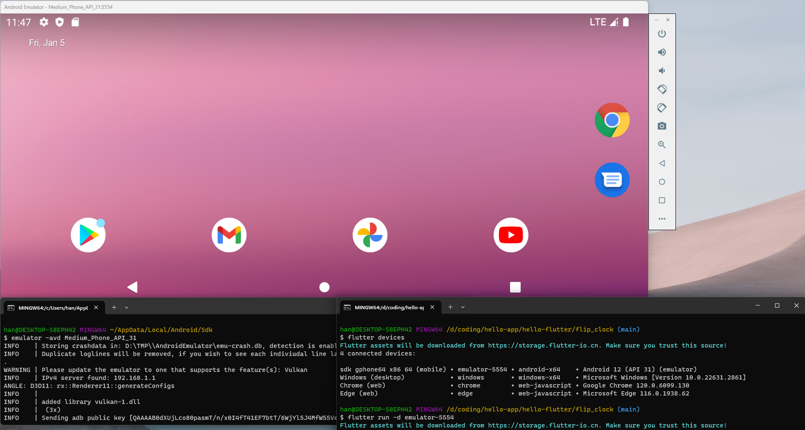

<!-- markdownlint-disable MD033 MD045 -->

# Hello App

跨平台应用开发框架示例集合，展示如何使用不同的技术栈开发运行在 **Windows**、**macOS**、**Linux**、**Android** 和 **iOS** 上的应用程序。

## 支持的框架

|Framework|平台支持|语言|引擎|特点|
|:--|:--|:--|:--|:--|
| [Electron](https://github.com/electron/electron)|桌面端 (Win/Mac/Linux)|JavaScript/TypeScript|Chromium + Node.js|Web 技术构建桌面应用|
| [Flutter](https://github.com/flutter/flutter)|全平台|Dart|Flutter Engine|Google 出品，高性能 UI|
| [Tauri](https://github.com/tauri-apps/tauri)|桌面端 (Win/Mac/Linux)|Rust + Web|WRY|轻量级，安全性高|
| [Expo](https://github.com/expo/expo)|移动端 + Web|TypeScript/JavaScript|React Native|快速开发，丰富生态|
|[GPUI](https://github.com/zed-industries/zed/tree/main/crates/gpui)|桌面端 (Win/Mac/Linux)|Rust|GPUI|Zed 的 UI 框架，GPU 自绘|
|[NSH](https://nsh.dev)|全平台|Rust（可混用 TSX）|GTK 4 / AppKit / Win32|Longbridge Native Shell，平台原生视图|

## 项目结构

```
hello-app/
├── hello-electron/          # Electron 桌面应用示例
│   ├── main.js              # 主进程
│   ├── index.html           # 渲染进程页面
│   └── package.json         # 项目配置
├── hello-flutter/           # Flutter 应用示例
│   ├── flip_clock/          # 翻页时钟应用
│   └── hello_flutter_app/   # 基础 Flutter 应用
├── hello-gpui/              # GPUI 桌面应用示例（纯 Rust，GPU 自绘）
│   ├── src/main.rs          # 应用与渲染
│   └── build.rs             # 链接路径自愈
├── hello-nsh/               # NSH 跨平台应用示例（纯 Rust，原生视图）
│   ├── src/lib.rs           # 根组件（#[component] App）
│   ├── src/main.rs          # 平台入口
│   └── nsh.json             # NSH 项目配置
├── hello-tauri/             # Tauri 应用示例
│   ├── hello-tauri-react/   # React 前端版本
│   ├── hello-tauri-svelte/  # Svelte 前端版本
│   ├── hello-tauri-vanilla/ # 原生 JS 版本
│   └── hello-tauri-vue/     # Vue 前端版本
└── hello-expo/              # Expo React Native 应用示例
    ├── app/                 # 应用页面 (文件路由)
    ├── components/          # 可复用组件
    ├── constants/           # 常量定义
    └── hooks/               # 自定义 Hooks
```

## 快速开始

### Electron (桌面应用)
```bash
cd hello-electron
npm install
npm start
```

### Flutter (移动/桌面应用)
```bash
cd hello-flutter/hello_flutter_app
flutter pub get
flutter run
```

### Tauri (桌面应用)
```bash
cd hello-tauri/hello-tauri-react
npm install
npm run tauri dev
```

### Expo (移动/Web应用)
```bash
cd hello-expo
npm install
npx expo start
# 使用 Expo Go 应用扫描二维码在手机上运行
```

### GPUI (纯 Rust 桌面应用)
```bash
cd hello-gpui
cargo run
# Linux 需要 Vulkan 与 libxkbcommon-x11 开发包（无 root 见「开发环境配置」）
```

### NSH (纯 Rust 跨平台应用)
```bash
cd hello-nsh
cargo run          # 或 nsh run（CLI 支持热重载与多平台打包）
```

## 技术栈对照

同一条「问候 + 当前时间」需求，六种技术栈各自实现，可以横向比较渲染方式与代码量：

| | Electron | Tauri | Flutter | Expo | GPUI | NSH |
|:--|:--|:--|:--|:--|:--|:--|
| 渲染 | Chromium | 系统 WebView | Skia 自绘 | 原生控件 | GPU 自绘 | 平台原生视图 |
| UI 语言 | HTML/CSS/JS | HTML/CSS/JS | Dart | React Native | Rust | Rust（+ TSX） |
| 业务语言 | JS | JS + Rust 壳 | Dart | TS | Rust | Rust |
| 桌面 | ✅ | ✅ | ✅ | — | ✅ | ✅ |
| 移动 | — | ✅ | ✅ | ✅ | — | ✅ |
| Web | — | — | ✅ | ✅ | ✅（WASM） | ✅ |

## 开发环境配置

### Node.js 源配置

```sh
npm config set registry https://registry.npmmirror.com
yarn config set registry https://registry.npmmirror.com
```

### Rust GUI 开发包（GPUI / NSH）

两个纯 Rust 示例在 Linux 上需要 Vulkan 与 xkbcommon-x11，NSH 还需要 GTK 4：

```sh
sudo apt install libgtk-4-dev libgraphene-1.0-dev libxkbcommon-x11-dev \
  libvulkan-dev vulkan-validationlayers
```

**无 root 时**：一条命令自愈 —— 把上述 `-dev` 包 `apt download` 下来、`dpkg-deb -x` 解包进
`~/.local/sysroot`，并为两个示例生成 `.cargo/config.toml`：

```sh
tools/ensure-env.sh
```

之后 `cargo run` 可直接工作：`PKG_CONFIG_PATH` 由生成的 `.cargo/config.toml` 提供，
`hello-gpui/build.rs` 同时把 sysroot 加进链接搜索路径（GPUI 在 Linux 上链接
`libxkbcommon-x11` / `libvulkan`）。生成的 config 含本机路径，故不入库。

### NSH CLI

```sh
curl -fsSL https://nsh.dev/install.sh | sh   # → ~/.local/bin/nsh
```

### Android 开发环境

> NDK 下载：<https://developer.android.com/ndk/downloads>

```sh
export ANDROID_HOME="$HOME/AppData/Local/Android/Sdk"
export NDK_HOME="/d/coding/android-ndk-r26b"
export PATH="$PATH:$ANDROID_HOME/tools/:$ANDROID_HOME/platform-tools/"
```

### Android 模拟器

查看可用的模拟器：
```sh
$ emulator -list-avds
Medium_Phone_API_31
```

启动模拟器：

```sh
emulator -avd Medium_Phone_API_31
```


